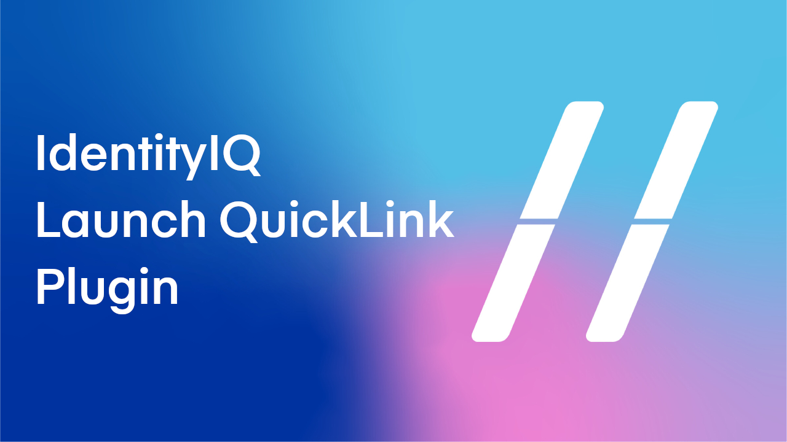
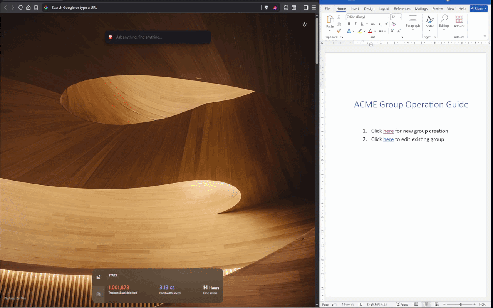
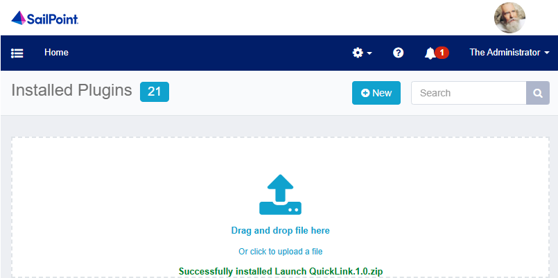
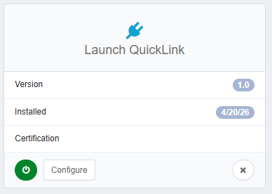

[![Discourse Topics][discourse-shield]][discourse-url]
[![Issues][issues-shield]][issues-url]
[![Latest Releases][release-shield]][release-url]
[![Contributor Shield][contributor-shield]][contributors-url]

[discourse-shield]:https://img.shields.io/discourse/topics?label=Discuss%20This%20Tool&server=https%3A%2F%2Fdeveloper.sailpoint.com%2Fdiscuss
[discourse-url]:https://developer.sailpoint.com/discuss/tag/workflows
[issues-shield]:https://img.shields.io/github/issues/sailpoint-oss/repo-template?label=Issues
[issues-url]:https://github.com/sailpoint-oss/repo-template/issues
[release-shield]: https://img.shields.io/github/v/release/sailpoint-oss/repo-template?label=Current%20Release
[release-url]:https://github.com/sailpoint-oss/repo-template/releases
[contributor-shield]:https://img.shields.io/github/contributors/sailpoint-oss/repo-template?label=Contributors
[contributors-url]:https://github.com/sailpoint-oss/repo-template/graphs/contributors

# IdentityIQ Launch QuickLink Plugin


[Explore the docs »](https://your-link-to-colab-topic-here)

[New to the CoLab? Click here »](https://developer.sailpoint.com/discuss/t/about-the-sailpoint-developer-community-colab/11230)

## Demo


## Installation

* Simply drag and drop the plugin `.zip` into IdentityIQ Plugin page to install.





## Configuration & Usage
Any available QuickLink in the navigation panel can be launched by constructing a URL with its canonical QuickLink name:

```text
https://iam.acme.com/identityiq/home.jsf?LaunchQL={QuickLink_Name}
```

> **Note on Name Matching:** The plugin matches on the canonical **QuickLink name** extracted from IdentityIQ's internal `chooseQuickLink` call arguments (e.g., `Request Access`, `Manage Access`), rather than localized display text. This ensures reliable matching across all user interface languages (English, German, French, Spanish, etc.).

If the QuickLink supports **For Me** and **For Others**, specify the recipient mode using `LaunchQLFor`:

**To Launch For Me (Default):**

```text
https://iam.acme.com/identityiq/home.jsf?LaunchQL={QuickLink_Name}
```
*Or explicitly:*
```text
https://iam.acme.com/identityiq/home.jsf?LaunchQL={QuickLink_Name}&LaunchQLFor=Me
```

**To Launch For Others:**

```text
https://iam.acme.com/identityiq/home.jsf?LaunchQL={QuickLink_Name}&LaunchQLFor=Others
```

## HTTP GET Request Behavior & Security Confirmation

* **GET Invocation:** The plugin activates upon navigating to `home.jsf` with the `LaunchQL` parameter passed in the HTTP `GET` query string.
* **Workflow Confirmation Prompt:** For security and safety, any **workflow-type QuickLink** (`action="workflow"`) prompts the user with a confirmation dialog before executing. This prevents unintended, automated execution of state-changing workflows (e.g. provisioning, lifecycle events, or modifications) through external or shared links. Standard navigation QuickLinks execute immediately without interruption.

## Verification
* Below example launches **Manage User Access / Request Access** directly without manual menu navigation:

```text
https://iam.acme.com/identityiq/home.jsf?LaunchQL=Request Access
```

## Compatibility & Maintenance Notice
* **Supported Versions:** IdentityIQ 8.0 through 8.4+.
* **Colab / Community Maintenance Responsibility:** This plugin is an open-source community/Colab project. It relies on the client-side QuickLinks panel (`#quicklinkPanel`) and the `SailPoint.Quicklinks.chooseQuickLink` JavaScript handler rendered by IdentityIQ. If future IdentityIQ releases modify the QuickLinks UI layout, DOM structure, or client-side execution framework, the repository/Colab author is responsible for updating and maintaining the plugin. This plugin is not an official product of SailPoint Technologies Inc.

## Feedback
* For bugs, feature enhancement requests, issues, or questions, please contact me on [LinkedIn](https://www.linkedin.com/in/shandeepsrinivas/) or [c.shandeep@gmail.com](mailto:c.shandeep@gmail.com).

<!-- CONTRIBUTING -->
## Contributing

Contributions are what make the open source community such an amazing place to learn, inspire, and create. Any contributions you make are **greatly appreciated**.

If you have a suggestion that would make this better, please fork the repo and create a pull request. You can also simply open an issue with the tag `enhancement`.
Don't forget to give the project a star! Thanks again!

1. Fork the Project
2. Create your Feature Branch (`git checkout -b feature/AmazingFeature`)
3. Commit your Changes (`git commit -m 'Add some AmazingFeature'`)
4. Push to the Branch (`git push origin feature/AmazingFeature`)
5. Open a Pull Request

<!-- LICENSE -->
## License

Distributed under the MIT License. See `LICENSE.txt` for more information.

<!-- CONTACT -->
## Discuss
[Click Here](https://developer.sailpoint.com/dicuss/tag/{tagName}) to discuss this tool with other users.
